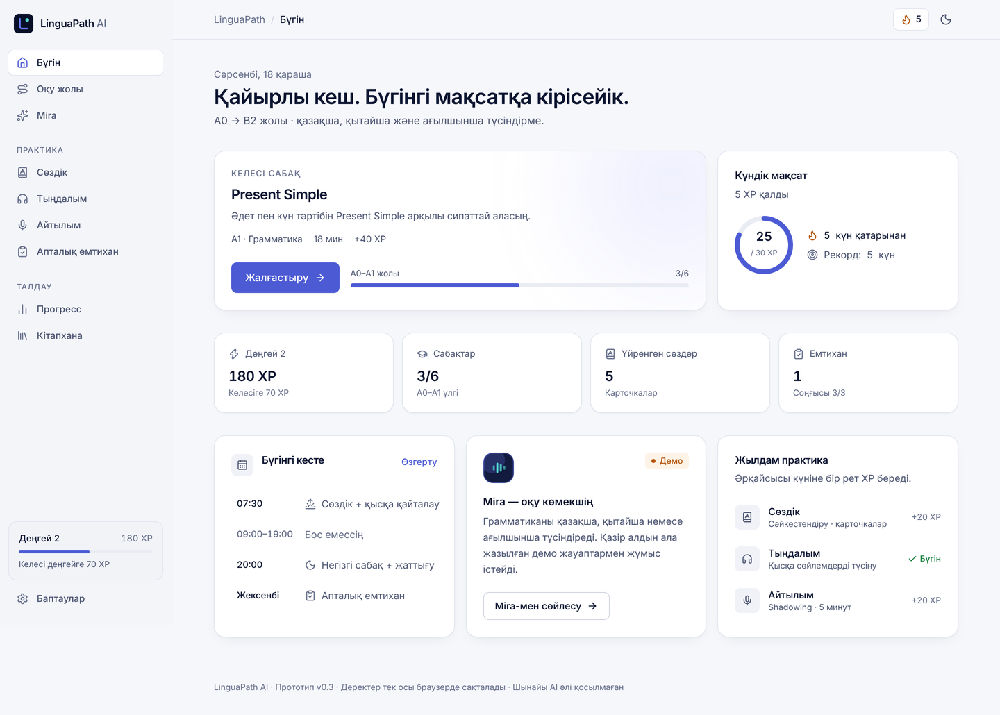
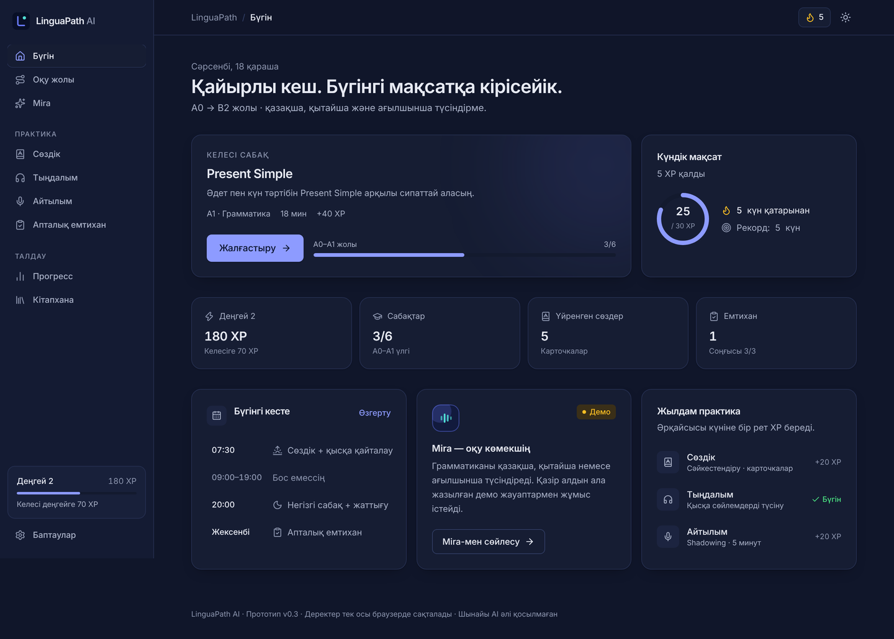
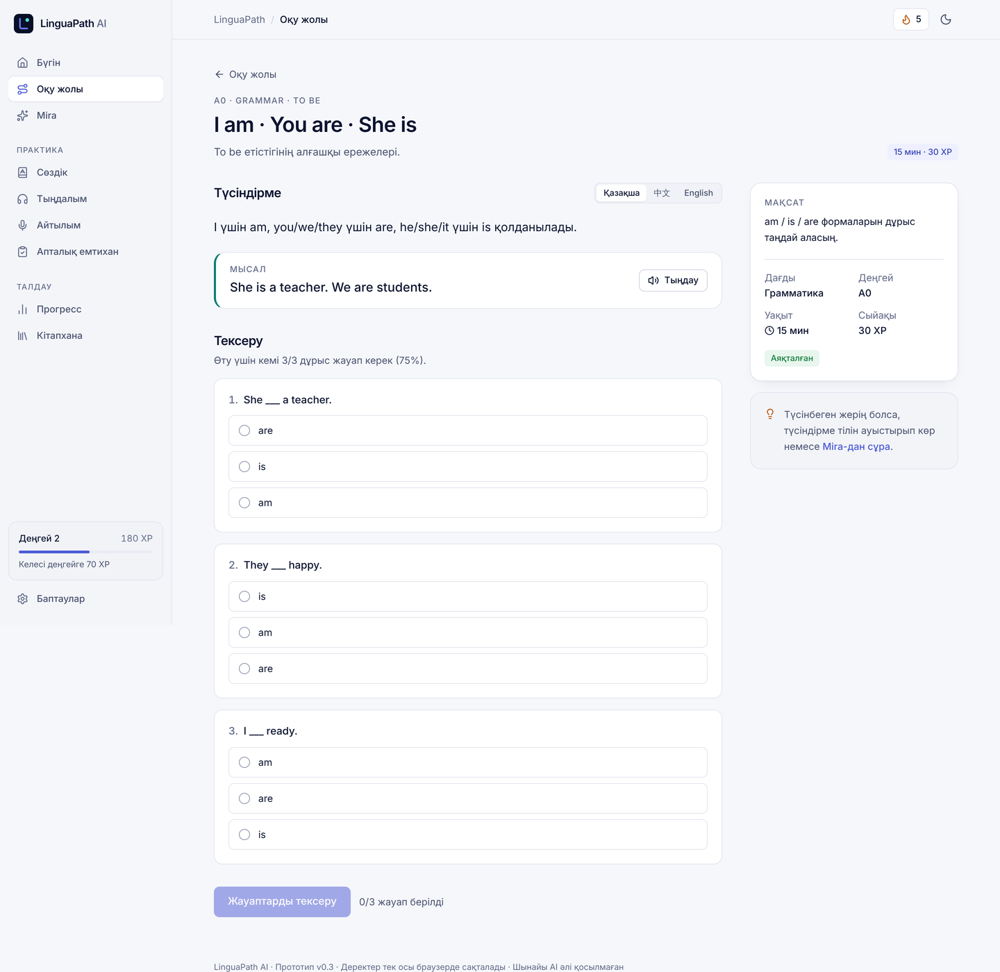
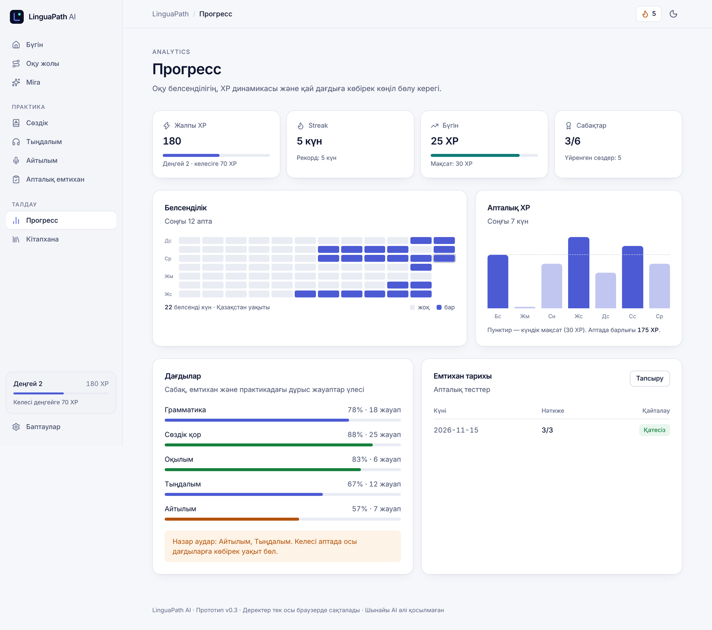
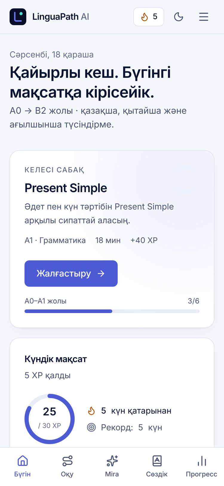
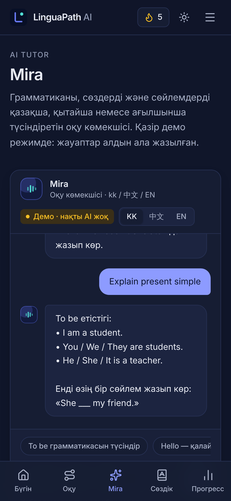
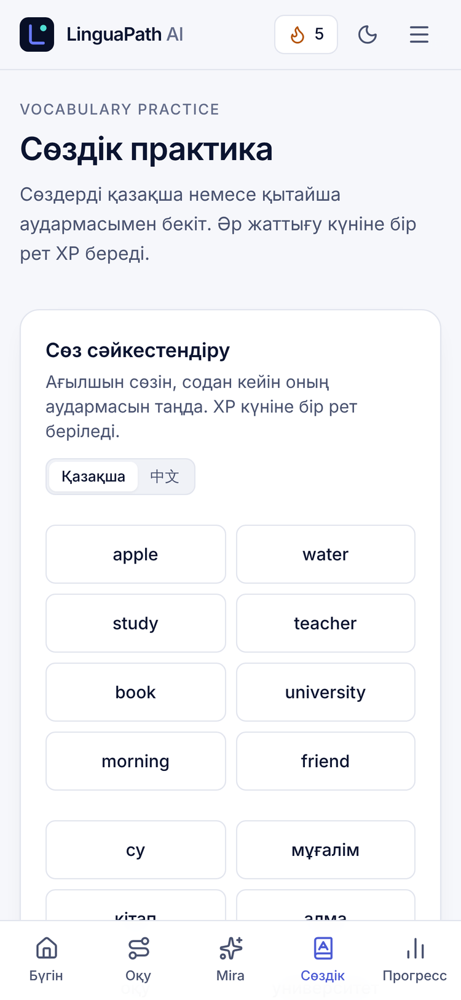

# LinguaPath AI — Next.js app (v0.3)

Production-oriented rebuild of the LinguaPath AI prototype with **Next.js 16 (App Router) + TypeScript (strict) + Tailwind CSS 4**.
The original static prototype stays in [`../website/`](../website/) as a reference.

> **Status:** front-end only. No Supabase and no real AI yet — Mira replies with clearly labelled **demo** answers. Progress is stored in this browser's `localStorage`.

Design system, page structure and component architecture: [DESIGN.md](DESIGN.md) (Kazakh).

| Light · desktop | Dark · desktop |
|---|---|
|  |  |
|  |  |

| Mobile · Today | Mobile · Mira (dark) | Mobile · Vocabulary |
|---|---|---|
|  |  |  |

## Features

- Today dashboard: next lesson, daily goal ring, streak, schedule (09:00–19:00 kept free), quick practice
- Learning roadmap A0 → B2 (A0–A1 authored, A2–B2 planned), lessons unlock at **75%**
- Lessons with kk / 中文 / English explanations and text-to-speech examples
- Mira AI tutor UI (demo replies in the chosen language; voice-ready avatar states)
- Vocabulary: word match (kk or 中文) + flashcards; Listening (browser TTS); Speaking (shadowing, optional local recording that is never uploaded)
- Weekly exam built only from completed lessons, with topic breakdown; XP only for improvement
- Progress analytics: level, streak, 12-week activity heatmap, weekly XP, skill accuracy, exam history
- Settings: explanation language, schedule validation, daily goal, light/dark theme, JSON export, reset
- Accessibility: skip link, landmarks, native radio groups, focus-visible, reduced motion, WCAG AA tokens
- SEO: per-page metadata, `sitemap.xml`, `robots.txt`, web manifest, icon

## Run locally

Requires Node.js 22+.

```bash
cd app-next
```

```bash
npm ci
```

```bash
npm run dev
```

Open <http://localhost:3000>.

## Checks

```bash
npm run lint
```

```bash
npm run typecheck
```

```bash
npm test
```

```bash
npm run build
```

End-to-end tests (Playwright, 1440px and 375px, light and dark, axe-core accessibility scan) run against the production build:

```bash
npx playwright install chromium
```

```bash
npm run build && npm run test:e2e
```

`.npmrc` sets `legacy-peer-deps=true`: vitest 4 has a cyclic optional peer chain that crashes npm 10. Required peers are listed explicitly in `package.json`.

## Environment

No secrets are needed. Optional: `NEXT_PUBLIC_SITE_URL` (canonical URL for sitemap/robots), see `.env.example`.
